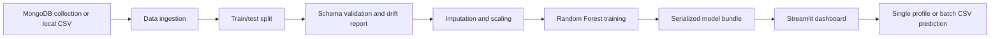

# Network Security Project Guide

## 1. What this project does

This repository contains a phishing website classification project. It takes a dataset of website and URL indicators, validates and preprocesses the data, trains a Random Forest classifier, saves a model bundle, and provides a Streamlit dashboard for predictions.

The project predicts from **engineered features** (for example, whether the URL contains an IP address or whether the page uses an iframe). It does not visit a URL, crawl a web page, or calculate these features from a URL by itself.

In the included dataset, `Result = -1` represents phishing and `Result = 1` represents legitimate. Treat model predictions as risk signals for investigation, not as a guarantee that a website is safe.

## 2. Big-picture flow



Run `python main.py` to execute the training pipeline from ingestion through model saving. Run `streamlit run app.py` to use the dashboard after a model has been trained.

## 3. Repository map

| Path | Purpose |
| --- | --- |
| `main.py` | Entry point for the training pipeline. Builds each component in sequence and prints the final model metrics and saved model path. |
| `app.py` | Streamlit web frontend for manual feature entry and CSV batch prediction. |
| `requirements.txt` | Python dependencies, including Streamlit, pandas, scikit-learn, PyMongo, and dill. |
| `setup.py` | Setuptools package metadata and package discovery. |
| `.env` | Local-only environment variables such as `MONGO_URL`. Keep credentials out of source control. |
| `.gitignore` | Excludes local environment files and the virtual environment. |
| `data_schema/schema.yaml` | Expected dataset columns and numerical column names. The target column is `Result`. |
| `Network_data/phisingData.csv` | Bundled phishing dataset used when MongoDB is not configured or cannot be reached. |
| `push_data.py` | Uploads the bundled CSV records to MongoDB database `first`, collection `NetworkData`. |
| `test_mongo.py` | Checks the MongoDB connection with a ping command using `MONGO_URL`. |
| `notebook/eda network.ipynb` | Exploratory data analysis notebook. |
| `Dockerfile` | Container build entry point; it is currently empty and is not used by the local run commands. |
| `Artifacts/` | Timestamped data, reports, preprocessing objects, and trained model bundles created by pipeline runs. |
| `logs/` | Log output created during pipeline runs. |

The Python package is named `network_Security` (capital `S`). Its important subdirectories are `components`, `entity`, `constants`, `exceptions`, `log`, and `utils`. The directories `cloud` and `pipline` are currently placeholders and are not used by the active pipeline.

## 4. Training pipeline, step by step

### 4.1 Pipeline setup

`TrainingPipelineConfig` in `network_Security/entity/config_entity.py` creates a timestamped artifact directory, such as `Artifacts/10_20_2026_10_19_04/`. The other config classes build file paths for their respective stages. This keeps outputs from separate runs in separate folders.

The constants in `network_Security/constants/training_pipeline/__init__.py` define the target column (`Result`), MongoDB database and collection names, train/test split ratio, schema path, and artifact subdirectory names.

### 4.2 Data ingestion

`DataIngestion` in `network_Security/components/data_ingestion.py` reads from MongoDB when `MONGO_URL` is set. It reads database `first` and collection `NetworkData`, removes MongoDB's `_id` field, writes a feature-store CSV, and splits the rows into training and test CSVs using a fixed random seed and an 80/20 split.

If `MONGO_URL` is missing, ingestion reads `Network_data/phisingData.csv`. If MongoDB access raises an error and that CSV exists, ingestion logs a warning and falls back to the local CSV. This means a successful `python main.py` run by itself does not prove that MongoDB was used; run `python test_mongo.py` to check the connection explicitly.

### 4.3 Data validation and drift report

`Data_Validation` in `network_Security/components/data_validation.py` reads the split files and checks that both have the exact columns, in the same order, as `data_schema/schema.yaml`. It also rejects empty files and columns containing only missing values.

For each numeric column, it runs a two-sample Kolmogorov-Smirnov test between the training and test partitions and writes p-values and drift flags to `data_validation/drift_report/report.yaml`. A p-value below `0.05` is reported as drift. The current pipeline writes the report but does not stop training when a drift flag is present.

Valid train and test copies are written to `data_validation/validated/`. Validation failures raise a `CustomException` and stop the pipeline.

### 4.4 Data transformation

`DataTransformation` in `network_Security/components/data_transformation.py` separates the feature columns from `Result`. It builds a scikit-learn `ColumnTransformer`:

- Numeric columns use median imputation followed by standard scaling.
- Non-numeric columns use most-frequent-value imputation.

The transformer is fitted on training features and applied to test features. Transformed CSV files and the serialized preprocessor are saved under `data_transformation/`. The target is kept separate for model training.

### 4.5 Model training and evaluation

`ModelTrainer` in `network_Security/components/model_trainer.py` fits a `RandomForestClassifier` with 200 trees, balanced class weights, and a fixed random seed. It evaluates the held-out test split with accuracy and weighted F1 score.

The model bundle is saved as `model_trainer/model.pkl`. It contains a dictionary with:

- `model`: the fitted classifier;
- `preprocessor`: the fitted feature transformer;
- `feature_names`: the ordered list of input features expected at prediction time.

`main.py` prints the model artifact path, test accuracy, and weighted F1. These scores describe the held-out split from that run; they are not a guarantee of future performance.

## 5. Frontend and predictions

`app.py` is a Streamlit dashboard with three tabs:

1. **Single analysis:** lets an analyst enter the 30 feature values using the dataset's -1, 0, and 1 encoding.
2. **Batch scan:** accepts a CSV with one row per website and the required model feature columns. It displays classifications and phishing confidence when available, and allows the result CSV to be downloaded.
3. **Feature guide:** lists the signals grouped by URL structure, domain/connection, page behavior, and reputation.

The app searches `Artifacts/*/model_trainer/model.pkl` and loads the newest model bundle. If there is no model yet, train one with `python main.py`. The batch CSV can omit `Result`; if it is included, it is ignored as an input because only the bundle's feature columns are selected.

A template can be downloaded in the Batch Scan tab. Its values are initialized to zero, so replace them with actual engineered feature values before interpreting predictions. The UI does not derive those values from a URL.

## 6. MongoDB setup

1. Create a MongoDB Atlas database user and allow your current IP address in Atlas Network Access.
2. Copy the Atlas application connection string and put it in the project-root `.env` file:

   ```dotenv
   MONGO_URL=mongodb+srv://<db-user>:<url-encoded-password>@<cluster-host>/?retryWrites=true&w=majority&appName=NetworkSecurity
   ```

3. Replace the placeholders with the values from Atlas. URL-encode special characters in the password. Do not commit `.env` or put credentials in Python files.
4. Verify the connection and then choose one of these actions:

   ```powershell
   python test_mongo.py
   python main.py
   ```

   `python test_mongo.py` should print `MongoDB connection successful`. `python main.py` reads from the configured database and collection when the connection succeeds.

To upload the local dataset into MongoDB, run `python push_data.py`. It inserts the CSV rows into `first.NetworkData`. Running it more than once inserts duplicate records; clear the collection first or add a unique-key/upsert strategy if repeatable uploads are needed.

The connection-check script previously contained a hard-coded connection URI. It now reads `MONGO_URL` from `.env`. If those old credentials were ever shared or pushed, rotate the MongoDB database user's password; Git history can retain earlier versions of a file.

## 7. Install and run

Use Python 3.10 or newer and run commands from the repository root. On Windows PowerShell:

```powershell
python -m venv .venv
.venv\Scripts\Activate.ps1
python -m pip install --upgrade pip
pip install -r requirements.txt
```

Train the model:

```powershell
python main.py
```

Start the frontend in a second terminal:

```powershell
streamlit run app.py
```

Streamlit prints a local address, usually `http://localhost:8501`, which can be opened in a browser.

If MongoDB is not configured, the pipeline can use the bundled CSV. If you want to verify MongoDB specifically, run `python test_mongo.py` before training.

## 8. How to read a run's artifacts

For a timestamped directory under `Artifacts/`:

- `data_ingestion.py/feature_store/NetworkData.csv`: dataset loaded for this run;
- `data_ingestion.py/ingested/train.csv` and `test.csv`: the raw split;
- `data_validation/validated/train.csv` and `test.csv`: files that passed validation;
- `data_validation/drift_report/report.yaml`: per-column drift p-values and flags;
- `data_transformation/transformed/train.csv` and `test.csv`: transformed feature matrices;
- `data_transformation/transformed_object/preprocessor.pkl`: fitted preprocessing transformer;
- `model_trainer/model.pkl`: model bundle used by the dashboard.

Older artifact directories are retained, allowing previous runs to be inspected. The frontend automatically chooses the model file with the most recently modified timestamp.

## 9. Supporting modules

- `network_Security/entity/artifact_entity.py` defines dataclasses that pass file paths and metrics between pipeline stages.
- `network_Security/utils/main_utils/utils.py` reads and writes YAML files and wraps utility errors in the project's custom exception.
- `network_Security/exceptions/exception.py` adds source file and line information to exceptions.
- `network_Security/log/logger.py` configures timestamped logging under `logs/`.
- `network_Security/components/__init__.py`, package `__init__.py` files, and most empty package modules make directories importable; they do not implement separate runtime stages.

## 10. Common issues

- **MongoDB fails but training continues:** ingestion may have used the local CSV fallback. Run `python test_mongo.py`; check `MONGO_URL`, Atlas IP access, database-user credentials, and network connectivity.
- **`MONGO_URL` is missing:** check that `.env` is in the repository root and that the variable is spelled exactly `MONGO_URL`.
- **Atlas authentication fails:** confirm the database user's password, not your Atlas website password. URL-encode special characters in the connection string password.
- **Validation reports wrong columns:** compare the CSV header to `data_schema/schema.yaml`; names and order must match, including `Result`.
- **The dashboard has no model:** run `python main.py` successfully first and confirm a `model_trainer/model.pkl` exists under `Artifacts/`.
- **A CSV upload is rejected:** include every feature listed in the Batch Scan template. `Result` is optional for inference.
- **The prediction seems unexpected:** verify that feature values use the dataset's -1/0/1 encoding and were engineered in the same way as the training data.
